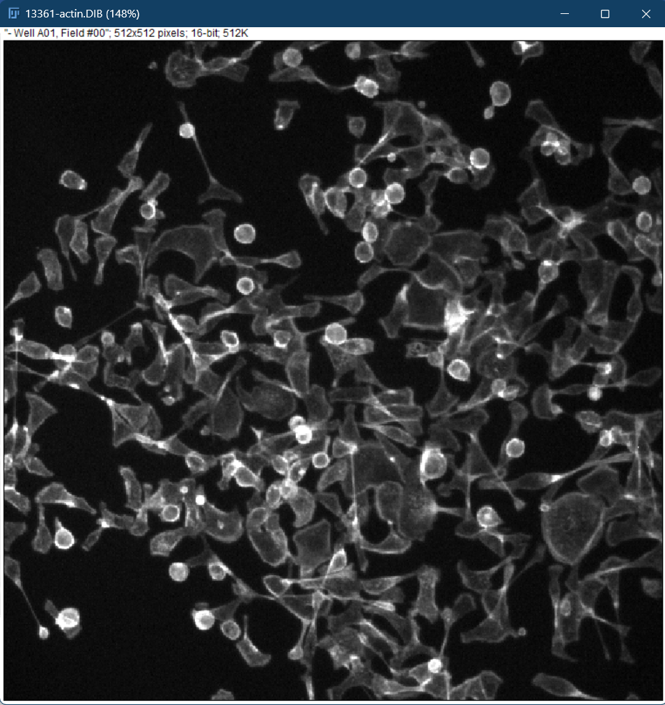
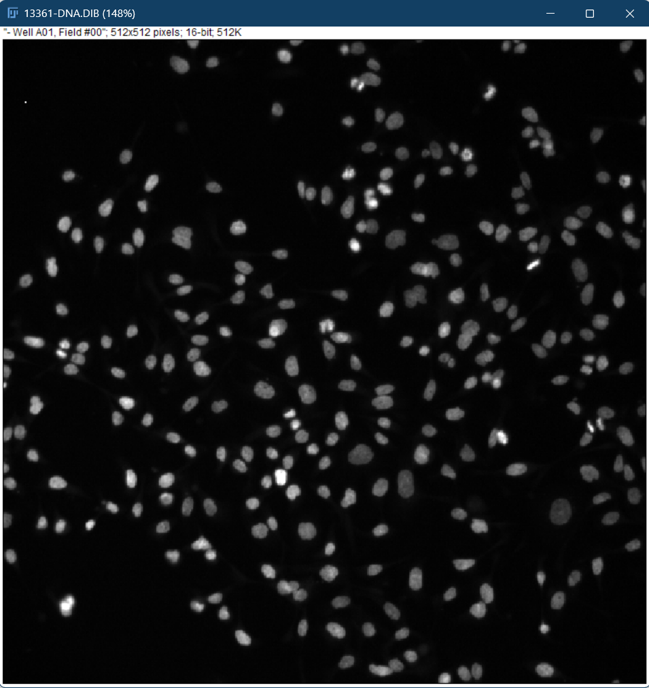
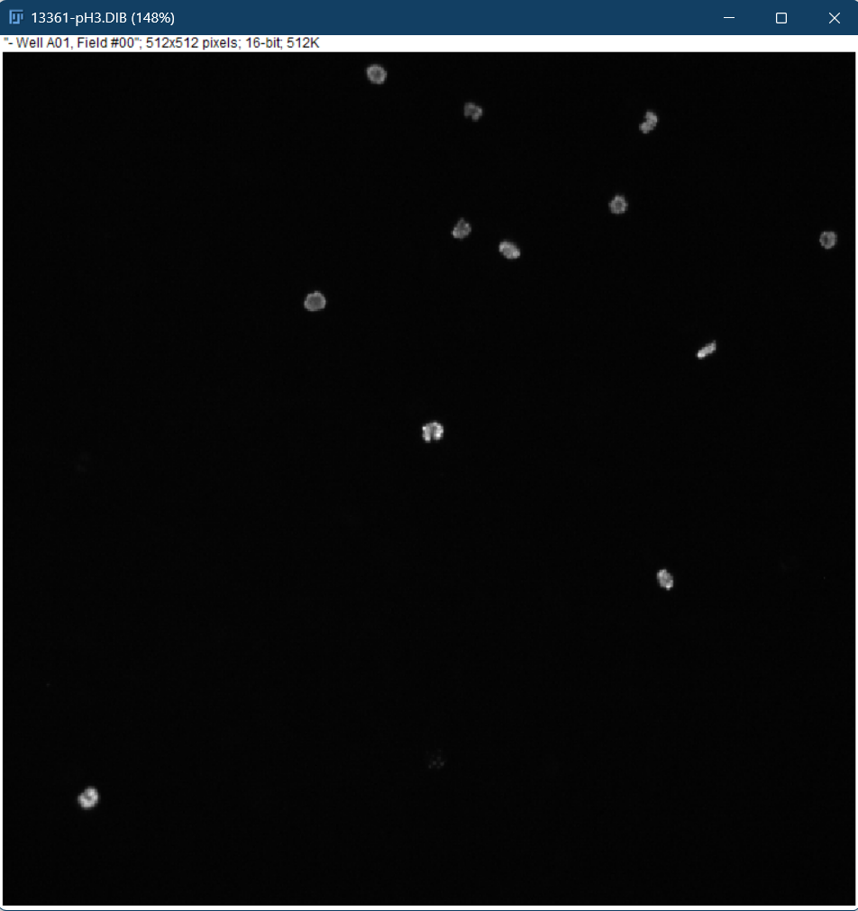
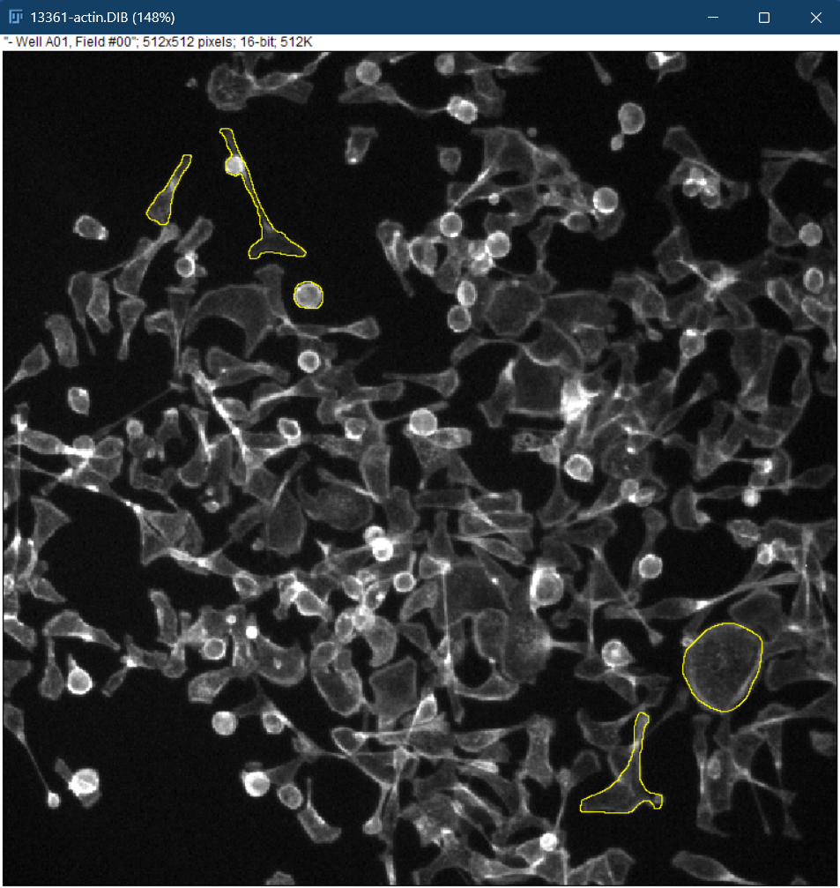
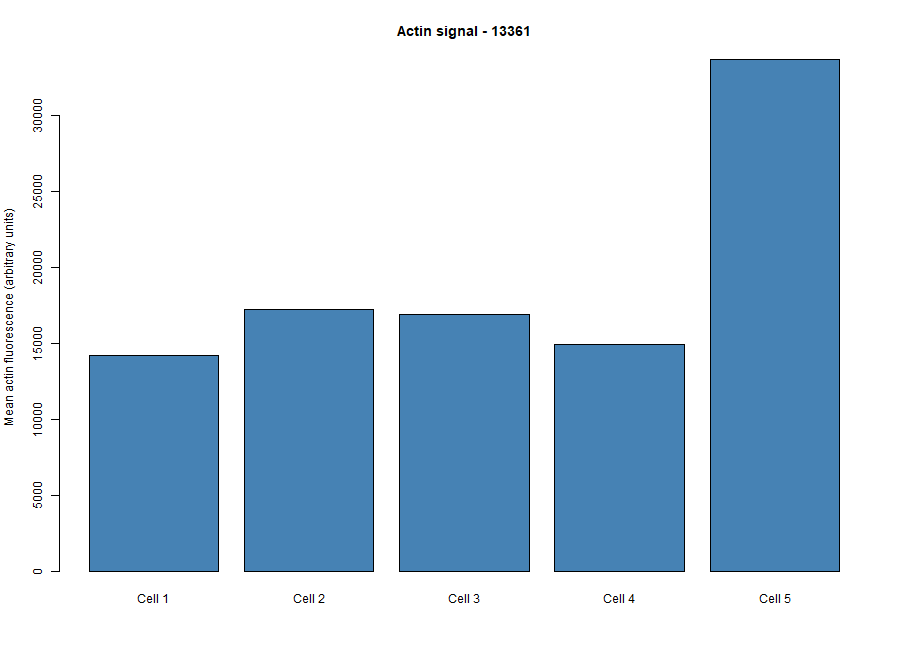
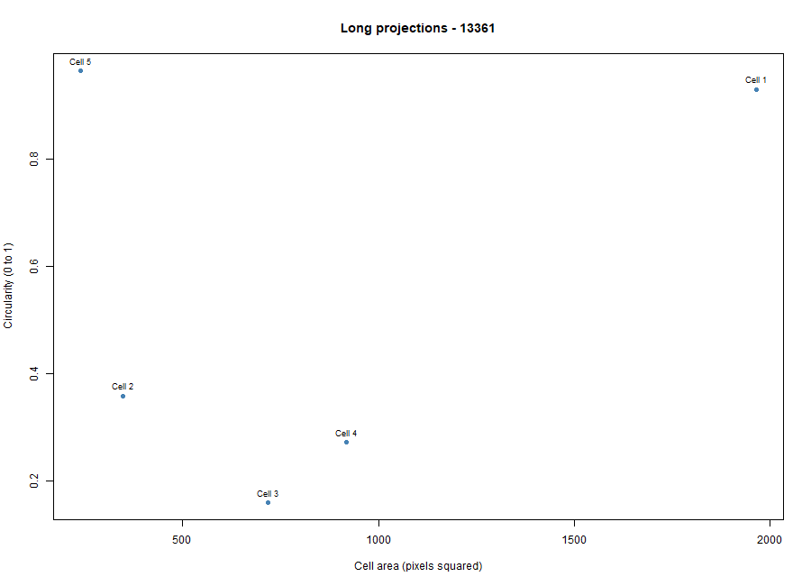

# Cytoskeleton and Cell Morphology

**Student ID:** 202303473

**Name:** Obiñeta, Inah Marie

**Date Completed:** October 21, 2026

**Phenotype:** Long projections 13361-actin.DIB, 13361-DNA.DIB

**Goal:** Download and choose your own fluorescence images of HT29 human colon-cancer cells, select one phenotype, measure five cells in Fiji, make two plots in R, and document your work on GitHub.

## Process

**Figure 1.** Fiji ImageJ Software Download Page for Windows Installation and Windows x86-64 version was selected for installation on a Windows computer.

**Figure 2.** Fiji software installed and ready (fiji-latest-win64-jdk)

**Figure 3.** Opening the .DIB images in Fiji with File > Import > Bio-Formats

**Figure 4.** Opening the field 13361 actin, DNA and pH3 images in Fiji (File > Open)

**Figure 5.** Measuring each traced cell with Analyze > Measure

**Figure 6.** Fiji Set Measurements: Area, Mean gray value, Shape descriptors, Display label

## Analyses & Answers

### Download, choose and register your OWN image

| Item | Answer |
|---|---|
| Phenotype chosen (visual classification) | Long projections |
| Image-field ID | 13361 |
| Actin filename | 13361-actin.DIB |
| DNA filename | 13361-DNA.DIB |
| Dataset page | <https://bbbc.broadinstitute.org/BBBC018> |
| Download link | <https://data.broadinstitute.org/bbbc/BBBC018/BBBC018_v1_images.zip> |
| Visible features supporting the phenotype | Several cells have long, thin actin extensions reaching away from the cell body |

**Figure 7.** BBBC018 reference example: Long projections (field 13361)

### Open your chosen fluorescence images in Fiji

**Figure 8.** Field 13361, F-actin channel (phalloidin), before measurement

**Figure 9.** Field 13361, DNA channel (Hoechst 33342), used as a guide for locating nuclei

**Figure 10.** Field 13361, pH3 channel (phospho-histone H3), optional reference

**Table 1.** The three fluorescence channels of field 13361 (pH3 is optional)

| | **Actin** | **DNA** | **pH3** |
|---|---|---|---|
| **Filename** | 13361-actin.DIB | 13361-DNA.DIB | 13361-pH3.DIB |
| **Stain** | Phalloidin | Hoechst 33342 | Phospho-histone H3 |
| **What it labels** | F-actin in the cell body and edges | DNA in the nucleus | A marker of cells in mitosis |
| **What you see** | Whole cell outlines, tails and projections, some bright round cells | One oval nucleus per cell, about 150 of them | Only about a dozen bright spots on a black background |
| **Used for** | Tracing and measuring your five cells | Locating nuclei and separating neighboring cells | Shows which cells are dividing. Cells round up during mitosis, so it explains why some cells in the actin image are bright and round with no tails. |

### Measure five cells in Fiji

**Figure 11.** Five traced cells measured on 13361-actin.DIB (yellow outlines)

**Figure 12.** ROI Manager with the five traced cells of field 13361

**Table 2.** Fiji measurements of five cells in field 13361 (13361-actin.DIB)

| | Label | Area | Mean | Min | Max | Circ. | AR | Round | Solidity |
|---|---|---|---|---|---|---|---|---|---|
| 1 | 13361-actin.DIB | 1965 | 14183.27 | 4083 | 34974 | 0.93 | 1.188 | 0.841 | 0.996 |
| 2 | 13361-actin.DIB | 348 | 17207.4 | 4939 | 44393 | 0.358 | 4.422 | 0.226 | 0.787 |
| 3 | 13361-actin.DIB | 718 | 16900.93 | 3161 | 65535 | 0.159 | 4.845 | 0.206 | 0.399 |
| 4 | 13361-actin.DIB | 919 | 14942.41 | 3161 | 54075 | 0.272 | 1.854 | 0.539 | 0.492 |
| 5 | 13361-actin.DIB | 239 | 33711.53 | 6981 | 64021 | 0.965 | 1.102 | 0.908 | 1 |

**Figure 13.** Mean actin fluorescence of the five measured cells in field 13361

**Figure 14.** Cell area versus circularity for the five measured cells in field 13361

## Explain your results

1. Which specific phenotype did you choose, and what visible features support that choice?

   I chose Long projections, which is my own visual classification and not a verified label. Several cells in field 13361 have a small cell body with a long, thin actin-stained tail that extends away from it, and four of my five traced cells show this.

2. Were your five cells mostly round or elongated? Refer to your circularity and aspect-ratio results.

   Mostly elongated or irregular. Three of the five cells had low circularity (0.16 to 0.36), and two of them had high aspect ratios (4.4 and 4.8). The other two cells were round, with circularity of 0.93 and 0.97 and an aspect ratio of about 1.1 to 1.2.

3. What role does actin play in maintaining cell shape and in cell movement (Karp Chapter 9)?

   Actin filaments form a network just under the plasma membrane that supports the cell's shape and allows it to form projections such as tails and protrusions. During movement, actin polymerizes at the leading edge to push the membrane forward, and with myosin and cell attachments it helps the cell crawl.

4. Why can a single fixed fluorescence image NOT show how fast a cell moves?

   Speed is distance travelled divided by time, so it needs the cell's position at two or more time points. A fixed image is a single snapshot of cells preserved at one moment, so there is no information about change over time.

## Upload your individual work to GitHub

Link: <https://github.com/iinahmariee/OBINETA-cytoskeleton-BBBC018-13361-actin/tree/GROUP-4>

## References

**Fiji (free):** <https://imagej.net/software/fiji/downloads>

**R (free):** <https://cran.r-project.org/>

**BBBC018 dataset page and phenotype examples:** <https://bbbc.broadinstitute.org/BBBC018>

**Direct download: BBBC018_v1_images.zip (46 MB):** <https://data.broadinstitute.org/bbbc/BBBC018/BBBC018_v1_images.zip>
